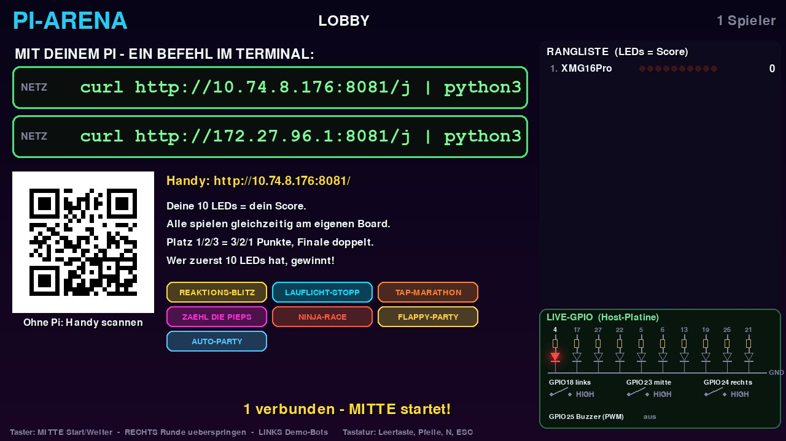
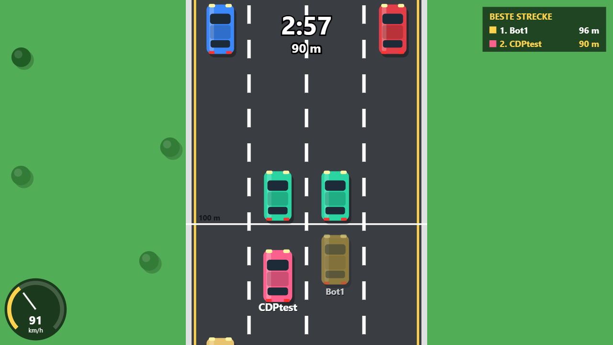
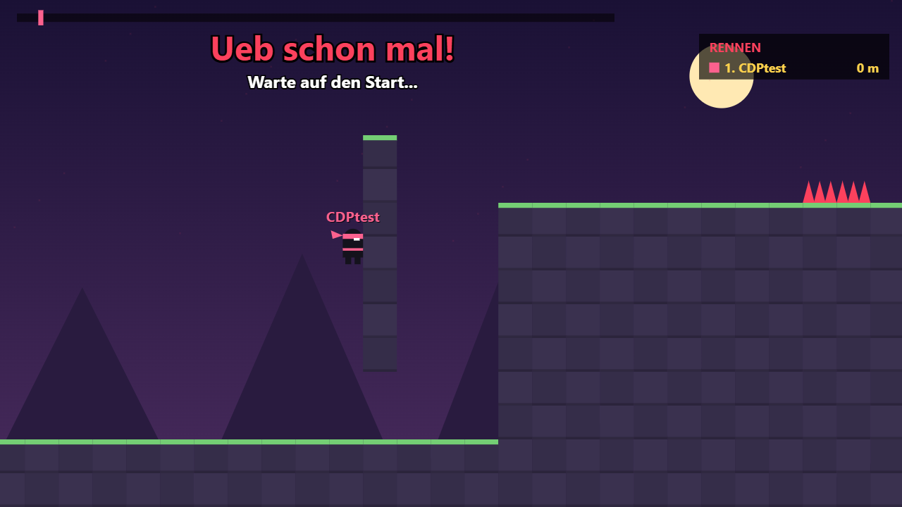
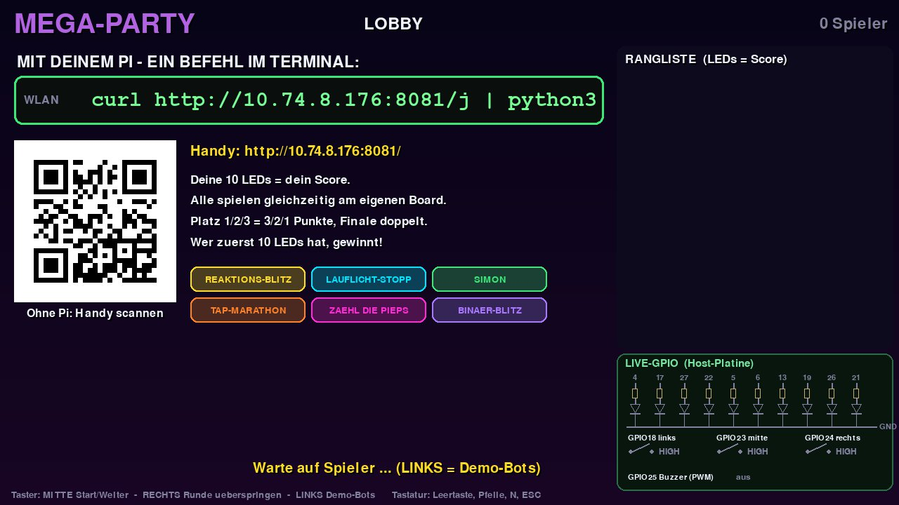

# PiArena – Multiplayer-Arena für die Raspberry-Pi-Platine

Die ganze Klasse spielt **gegeneinander**, jede/r am eigenen Raspberry Pi mit derselben selbst
gelöteten Platine (10 LEDs, 3 Taster, Buzzer). Ein Pi mit Monitor oder Beamer ist der **Host**: Er zeigt
die Lobby, sagt die Runden an, zählt mit und kürt am Ende den Sieger. Die **10 LEDs auf deiner Platine sind
dein Punktestand**: Wer zuerst alle 10 leuchten hat, gewinnt.

Kein Login auf fremden Geräten, keine Cloud: Alles läuft im Schulnetz, jede/r tritt mit **einem Befehl**
am eigenen Pi bei – oder per QR-Code mit dem Handy. Der Code ist offen (MIT-Lizenz) und so aufgebaut,
dass man **eigene Minispiele in einer einzigen Datei** dazubauen kann.

> 📄 **Anleitung als PDF für den Unterricht:** [`docs/PiArena_Anleitung.pdf`](docs/PiArena_Anleitung.pdf) –
> Schritt für Schritt zum Austeilen, auch ohne Vorwissen.



## Was es kann

- **Taster-Minispiele direkt auf der Platine:** Reaktions-Blitz, Lauflicht-Stopp, Tap-Marathon,
  Zähl die Pieps. Alle Boards spielen gleichzeitig dasselbe Spiel, gemessen wird am eigenen Pi
  (keine Netzwerk-Verzögerung).
- **Browser-Runden für alle gleichzeitig:** NINJA-RACE (Jump'n'Run), FLAPPY-PARTY und AUTO-PARTY.
  Alle sind in derselben Welt unterwegs und sehen die anderen mit Namen. Am Schüler-Pi geht das Spiel
  von selbst im Vollbild auf.
- **Handy statt Pi:** Wer keinen Pi hat, scannt den QR-Code und spielt im Handy-Browser mit.
- **Moderation mit den 3 Tastern des Hosts:** Start/Weiter, Runde überspringen, Demo-Bots.
  Die Lehrkraft braucht keine Tastatur.
- **Wertung:** Platz 1/2/3 bekommt 3/2/1 Punkte, die letzte Runde (Finale) zählt doppelt.
- **Live-GPIO am Monitor:** Ein Schaltbild zeigt in Echtzeit, welche LED, welcher Taster und welcher
  Buzzer-Ton an der Host-Platine gerade aktiv ist. Ideal zum Erklären.
- **Live-Bild fürs Klassenzimmer:** `http://<HOST>:8081/live` zeigt den Monitor des Hosts in jedem Browser.

| AUTO-PARTY im Browser | NINJA-RACE im Browser |
|---|---|
|  |  |



> Die Screenshots sind aus der Entwicklung (Oktober 2026). Die Spiele-Auswahl in der Lobby kann sich
> inzwischen geändert haben.

## Hardware

Pro Teilnehmer/in (Host und jeder Schüler-Pi gleich):

- Raspberry Pi 4 oder 5 mit Raspberry Pi OS **mit Desktop** (Bookworm oder Trixie), Python 3.11+
- die Platine: **10 LEDs** (je 220–330 Ω Vorwiderstand), **3 Taster** gegen GND (interner Pull-up,
  kein Widerstand nötig), **1 passiver Buzzer**
- der Host zusätzlich: Monitor oder Beamer (HDMI)

| Bauteil | GPIO (BCM) |
|---|---|
| LEDs 1–10 (links → rechts) | 4, 17, 27, 22, 5, 6, 13, 19, 26, 21 |
| Taster LINKS / MITTE / RECHTS | 18 / 23 / 24 |
| Buzzer (passiv) | 25 |

Andere Pins: in [`arena/spieler.py`](arena/spieler.py) `LED_PINS`, `TASTER`, `BUZZER_PIN` ändern.
Pin-Nummern am Stecker und ein Schaltbild stehen in der [Anleitung](ANLEITUNG.md#2-die-platine).
Fehlt ein Bauteil oder ist ein Pin belegt, läuft das Programm trotzdem weiter (der Pin wird übersprungen).
Ohne Platine (Laptop) geht alles mit `--sim`.

<!-- Platzhalter: Hier fehlt noch ein Foto der gelöteten Platine (z. B. docs/bilder/platine.jpg). -->
> 📷 *Foto der Platine: folgt.*

## Steuerung

**Schüler-Pi (Platine):** Die 3 Taster sind die Eingabe für die Minispiele, was sie gerade machen, steht
in der Ansage am Monitor. Zwischen den Runden zeigen die LEDs den Punktestand. Blinken LED 1 und 10
abwechselnd, sucht der Pi noch den Host. Ohne Platine (`python3 arena/spieler.py --sim`): `A` `S` `D` =
links/mitte/rechts, `Q` = Ende.

**Host (Moderation)**, mit den Tastern der Host-Platine oder der Tastatur:

| Wann | LINKS (`←`) | MITTE (`Leertaste`/`Enter`) | RECHTS (`→`/`N`) |
|---|---|---|---|
| Lobby | Demo-Bots an/aus | Partie starten | – |
| Ansage / Runde | – | – | Runde überspringen |
| Ergebnis | – | sofort weiter | – |
| Siegerehrung | – | neue Partie | – |

`ESC` = zurück in die Lobby, in der Lobby beendet `ESC` das Programm. Spielt der Host mit, gehören seine
Taster während einer Taster-Runde dem Spiel; im Fenster-Modus sind `A` `S` `D` seine eigenen Taster.

**Handy:** Knöpfe bzw. Eingabefeld auf der Handy-Seite. Taster-Spiele, die echte LEDs brauchen
(z. B. LAUFLICHT-STOPP), setzen Handy-Spieler aus.

## Schnellstart in 3 Schritten

Auf dem **Host-Pi** (der mit dem Monitor), im Terminal:

```bash
git clone https://github.com/Pholippo/pi-arena.git && cd pi-arena   # 1. holen
./install.sh                                                     # 2. einrichten
./start.sh                                                       # 3. starten
```

Danach zeigt der Monitor den Beitritts-Befehl. Jede Schülerin und jeder Schüler tippt ihn **am eigenen Pi** ein:

```bash
curl http://<IP-VOM-HOST>:8081/j | python3
```

Kein Internet am Pi? Ordner per USB-Stick kopieren, das steht in der [Anleitung](ANLEITUNG.md#3-projekt-auf-den-host-pi-holen).

## Eigenes Minispiel in 3 Schritten

1. In [`arena/minispiele.py`](arena/minispiele.py) das Beispiel `spiel_morse` anschauen und kopieren (eine Funktion + eine Zeile in `SPIELE`).
2. Testen, ohne andere Spieler: `python3 arena/host.py --fenster --nur morse` (Pfeil links = Demo-Bots, Leertaste = Start, `A` `S` `D` = Taster).
3. Fertig? In [`arena/einstellungen.py`](arena/einstellungen.py) aus `DEAKTIVIERT` nehmen – ab jetzt kommt es in jeder Partie dran.

Ausführlich: [MITMACHEN.md](MITMACHEN.md).

## Ordner

| Ordner / Datei | Inhalt |
|---|---|
| `arena/` | **Das Hauptprogramm.** `host.py` = Host (Monitor, Lobby, Wertung), `spieler.py` = Programm für jeden Schüler-Pi, `minispiele.py` = die Taster-Spiele, `einstellungen.py` = Runden/Punkte/deaktivierte Spiele. Alle Dateien erklärt in [arena/README.md](arena/README.md) |
| `arena/web/` | Browser-Spiele (`ninja.html`, `flappy.html`, `auto.html`) und Handy-Seite (`handy.html`) |
| `extras/` | Einzelspiele vom Projektanfang (LED-Arcade, TURBO-BLITZ, PAC-PI, Anmeldung). Siehe [extras/README.md](extras/README.md) |
| `tests/` | Automatische Tests. Alle auf einmal: `python3 tests/run_all.py`. Nur die schnellen Logik-Tests (ohne pygame, ohne Platine): `python3 -m unittest discover -s tests -p "test_*.py"` |
| `tools/web-vorlagen/` | Vorlagen, aus denen `build.py` die drei Browser-Spiele baut. Siehe [MITMACHEN.md](MITMACHEN.md#browser-spiele-ändern-vorlagen-in-toolsweb-vorlagen) |
| `docs/` | Screenshots und die PDF-Anleitung |
| `install.sh`, `start.sh`, `stop.sh` | Einrichten, Host starten, alles beenden |

## Weiterlesen

- **[ANLEITUNG.md](ANLEITUNG.md)**: für Lehrkräfte, Schritt für Schritt ohne Programmierkenntnisse
  (Platine, SD-Karte, Start, Ablauf einer Partie, Fehlerbehebung).
- **[MITMACHEN.md](MITMACHEN.md)**: für Schülerinnen und Schüler, die weiterentwickeln wollen
  (Aufbau, Protokoll, eigenes Minispiel, Tests, Git-Workflow).

## Lizenz

[MIT](LICENSE): Benutzen, verändern und weitergeben ist ausdrücklich erlaubt, auch im Unterricht
anderer Schulen. Bitte den Lizenztext mitgeben.

## Credits

Entstanden in der HTL-Werkstätte, Klasse 3AHEL, 2026 (damals noch unter dem Namen „MEGA-PARTY“).
Idee & Platine: Philipp Grabner. Code mit KI-Unterstützung (Claude).
Danke an die Klasse fürs Testen und Feedback geben.
