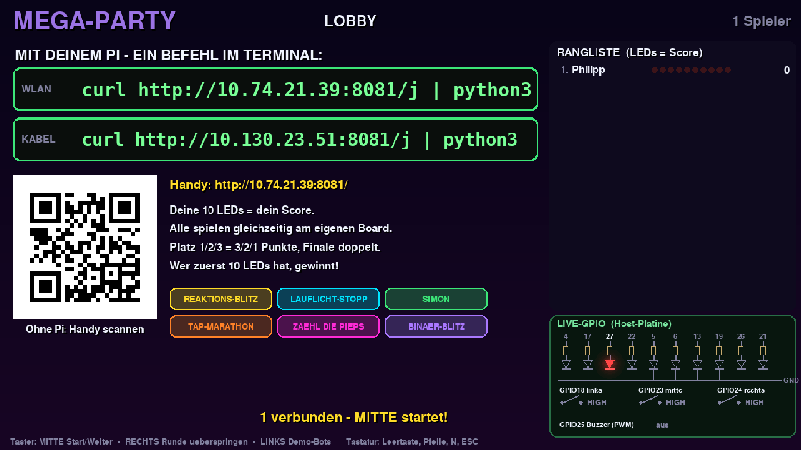
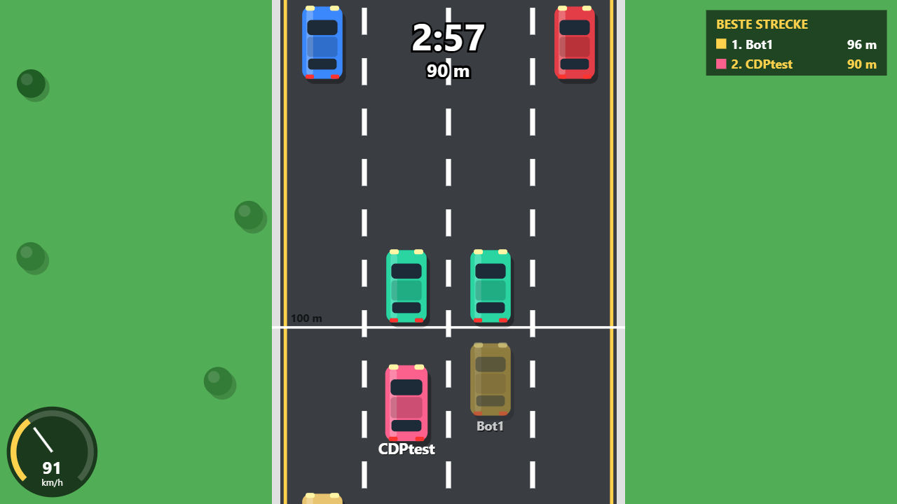
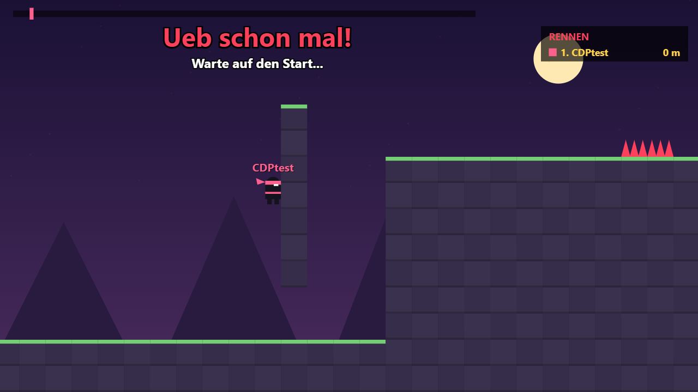
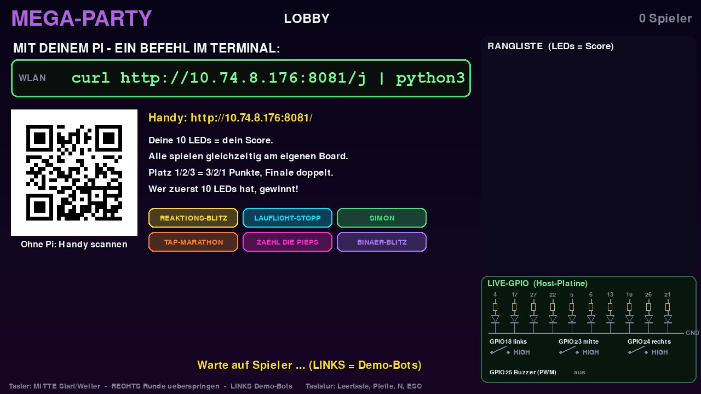

# MEGA-PARTY – das Klassen-Battle für die Raspberry-Pi-Platine

Eine ganze Klasse spielt **jeder gegen jeden**, jede/r am eigenen Raspberry Pi mit derselben selbst
gelöteten Platine (10 LEDs, 3 Taster, Buzzer). Ein Pi mit Monitor oder Beamer ist der **Host**: Er zeigt
die Lobby, sagt die Runden an, zählt mit und kürt am Ende den Sieger. Die **10 LEDs auf deiner Platine sind
dein Punktestand**: Wer zuerst alle 10 leuchten hat, gewinnt.

Kein Login auf fremden Geräten, keine Cloud: Alles läuft im Schulnetz, jede/r tritt mit **einem Befehl**
am eigenen Pi bei – oder per QR-Code mit dem Handy.



## Was es kann

- **Taster-Minispiele direkt auf der Platine:** Reaktions-Blitz, Lauflicht-Stopp, Tap-Marathon,
  Zähl die Pieps. Alle Boards spielen gleichzeitig dasselbe Spiel, gemessen wird am eigenen Pi
  (keine Netzwerk-Verzögerung).
- **Browser-Runden für alle gleichzeitig:** NINJA-RACE (Jump'n'Run), FLAPPY-PARTY und AUTO-PARTY.
  Alle sind in derselben Welt unterwegs und sehen die anderen mit Namen. Am Schüler-Pi geht das Spiel
  von selbst im Vollbild auf.
- **Handy statt Pi:** Wer keinen Pi hat, scannt den QR-Code und spielt im Handy-Browser mit.
- **Moderation mit den 3 Tastern des Hosts:** Start/Weiter, Runde überspringen, Demo-Bots.
  Die Lehrkraft braucht keine Tastatur.
- **Wertung:** Platz 1/2/3 bekommt 3/2/1 Punkte, die letzte Runde (Finale) zählt doppelt.
- **Live-GPIO am Monitor:** Ein Schaltbild zeigt in Echtzeit, welche LED, welcher Taster und welcher
  Buzzer-Ton an der Host-Platine gerade aktiv ist. Ideal zum Erklären.
- **Live-Bild fürs Klassenzimmer:** `http://<HOST>:8081/live` zeigt den Monitor des Hosts in jedem Browser.

| AUTO-PARTY im Browser | NINJA-RACE im Browser |
|---|---|
|  |  |



> Die Screenshots sind aus der Entwicklung (Oktober 2026). Die Spiele-Auswahl in der Lobby kann sich
> inzwischen geändert haben.

## Schnellstart in 3 Schritten

Auf dem **Host-Pi** (der mit dem Monitor), im Terminal:

```bash
git clone https://github.com/Pholippo/raspi-klassen-party.git && cd raspi-klassen-party   # 1. holen
./install.sh                                                                         # 2. einrichten
./start.sh                                                                           # 3. starten
```

Danach zeigt der Monitor den Beitritts-Befehl. Jede Schülerin und jeder Schüler tippt ihn **am eigenen Pi** ein:

```bash
curl http://<IP-VOM-HOST>:8081/j | python3
```

Kein Internet am Pi? Ordner per USB-Stick kopieren, das steht in der [Anleitung](ANLEITUNG.md#3-projekt-auf-den-host-pi-holen).

## Ordner

| Ordner / Datei | Inhalt |
|---|---|
| `party/` | **Das Hauptspiel MEGA-PARTY.** `mega.py` = Host (Monitor, Lobby, Wertung, Port 8081), `mega_client.py` = Client für jeden Schüler-Pi (liefert der Host selbst aus), `webspiele.py` = Server für die Browser-Spiele (Port 8082), `ninja.html` / `flappy.html` / `auto.html` = die Browser-Spiele, `web_client.html` = Handy-Seite, `qrgen.py` = QR-Code-Generator ohne Zusatz-Pakete |
| `extras/` | Einzelspiele vom Projektanfang (LED-Arcade, TURBO-BLITZ, PAC-PI, Anmeldung). Siehe [extras/README.md](extras/README.md) |
| `tests/` | Automatische Tests. Alle auf einmal: `python3 tests/run_all.py` |
| `tools/web-vorlagen/` | Vorlagen, aus denen `build.py` die drei Browser-Spiele baut (gemeinsamer PARTY-UI-Block). Siehe [MITMACHEN.md](MITMACHEN.md#browser-spiele-ändern-vorlagen-in-toolsweb-vorlagen) |
| `docs/bilder/` | Screenshots für diese Seite |
| `install.sh`, `start.sh`, `stop.sh` | Einrichten, Host starten, alles beenden |

## Weiterlesen

- **[ANLEITUNG.md](ANLEITUNG.md)**: für Lehrkräfte, Schritt für Schritt ohne Programmierkenntnisse
  (Platine, SD-Karte, Start, Ablauf einer Partie, Fehlerbehebung).
- **[MITMACHEN.md](MITMACHEN.md)**: für Schülerinnen und Schüler, die weiterentwickeln wollen
  (Aufbau, Protokoll, eigenes Minispiel, Tests, Git-Workflow).

## Lizenz

[MIT](LICENSE): Benutzen, verändern und weitergeben ist ausdrücklich erlaubt, auch im Unterricht
anderer Schulen. Bitte den Lizenztext mitgeben.

## Credits

Entstanden in der HTL-Werkstätte, Klasse 3AHEL, 2026.
Idee & Platine: Philipp Grabner. Code mit KI-Unterstützung (Claude).
Danke an die Klasse fürs Testen und Feedback geben.
